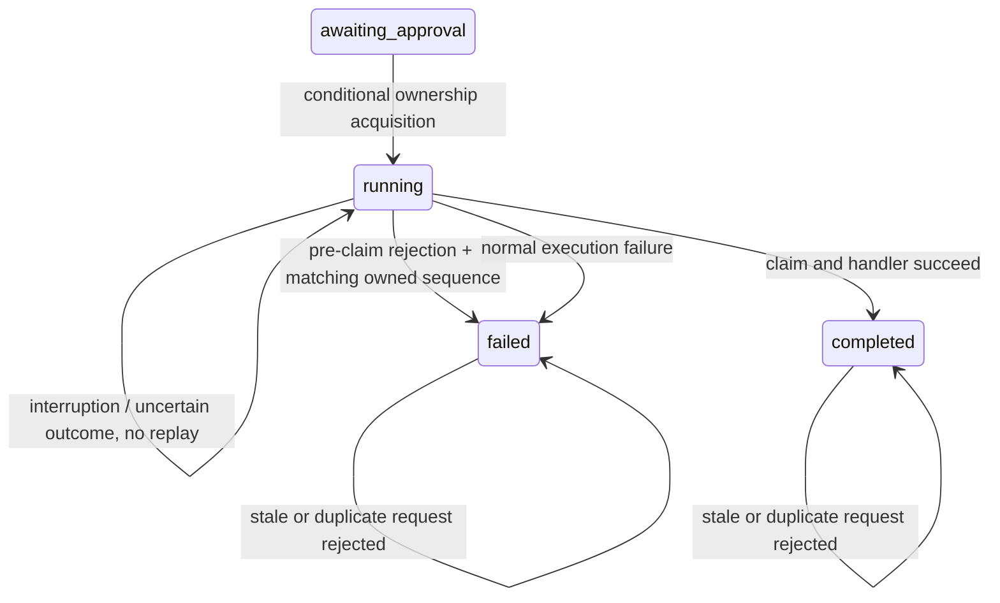

# NOVA-R01-C02 Implementation and Practical Verification Report

## Implementation Summary
Implemented the approved F02 approval lifecycle correction. A pending approval is conditionally acquired in SQLite before it is resolved. Only that execution owner proceeds. The executor emits tool.started after its authorization claim commits. A definitive pre-claim rejection persists FAILED and a correlated task.failed event together, then returns HTTP 409 with the persisted task_status. A conflicting terminal winner is preserved and reported without converting the rejected request into success.

No dependency was installed, no commit or push was made, and R02 was not started. Tests and live processes used synthetic temporary workspaces. Existing evidence was retained.

## Environment and baseline
Windows, repository C:\NOVA, branch main, Git HEAD e5785edd5338ea8a5d2b4e2bc2cebed4673777a0. Tests used the existing .venv Python 3.10.0 and pytest 8.4.2. The working tree was already dirty. baseline.json records pre-edit hashes of application/test Python files; git-before.txt and git-after.txt record the working tree. changed-files.json lists files changed relative to that baseline, rather than attributing all uncommitted R01/C01 changes to C02.

## Architectural Reasoning and ADR Compliance
The correction remains in the existing graph orchestration, SQLite checkpoint, executor and API layers. ADR-001: local persistence only. ADR-002/009: correlated events with recoverable terminal SSE data. ADR-003: conditional graph checkpoint transitions. ADR-006: checkpoint/executor ports updated with optional parameters. ADR-010: policy recheck and single-use claim remain in BEGIN IMMEDIATE within the authorization database. No new service or framework.

## Internal Workflow and Data Flow
1. Load the pending checkpoint and validate node/proposal identity.
2. Compare its sequence in the checkpoint write transaction. Persist RUNNING with a generated approval_attempt_id. A competing submission cannot acquire the same sequence. The marker is retained through state copies and prevents ordinary recovery from replaying an owned action.
3. Record the user decision and evaluate permission through the existing gate.
4. Executor validates the proposal, schema and sandbox. The authorization transaction validates the existing ledger record, checks persisted policy, claims the token and records the claim. Already-claimed authorization is a distinct exception, checked before expiry/policy rejection so an execution winner is not mistaken for a rejected pending action.
5. Only after claim commit does the executor invoke the optional on_started callback and then the actual handler.
6. On definitive authorization rejection, compare the owned checkpoint sequence again. Commit the failed checkpoint, its task.failed payload and reservation in one transaction. If stale, load the winner and retain its outcome. Return a conflict with that persisted status.
7. SSE merges the process event list with stored task terminal events, deduplicating by event_id. Restart can therefore return the same terminal event even when in-memory publication failed.

## Database and concurrency design
Additive task_terminal_events(task_id PRIMARY KEY, event_json) resides in the existing checkpoint database. Prior checkpoint history and terminal_event_claims are preserved. The new nullable approval_attempt_id defaults to None when reading older checkpoints.

The rejection transaction compares expected_seq with the latest checkpoint under BEGIN IMMEDIATE. A changed sequence aborts its write. Terminal protection additionally refuses replacing completed, failed or cancelled outcomes. Ordinary writers cannot overwrite a checkpoint belonging to a different approval owner. There is one durable task terminal event per task. SQLite connection contexts now explicitly close connections, including exceptions.

Authorization and checkpoint databases remain separate: there is no claim of a cross-database transaction or an atomic filesystem-plus-SQLite write. The ownership marker is intentionally conservative across crashes. Claim-first actions remain executable after a later revocation. Rejected requests never receive a fabricated successful result, even if another execution won.

## Files Changed
Application files (paths relative to services/backend/src/nova):
- core/orchestration/checkpoint.py: conditional sequence writes, owner guard, atomic terminal event storage, event reads, synchronized in-memory CAS, explicit SQLite close.
- core/orchestration/state.py: optional approval ownership marker and preservation in immutable state copies.
- core/orchestration/engine.py: ownership acquisition, conditional rejection finalization, terminal persistence/publication, post-claim start callback, recovery guard, correlation retention.
- core/orchestration/ports.py: optional start callback and distinct already-claimed exception.
- core/permissions/authorization.py: classify already-claimed records before expiry/policy rejection while retaining the atomic claim boundary.
- core/permissions/sandbox_and_audit.py: invoke the start callback after the committed claim and before the real handler.
- api/app.py: durable terminal SSE merge, hide approval cards for nonpending tasks, structured finalized conflict response.
- api/assistant_ui.py: retain HTTP 409 and detail while adding task_id/task_status for finalized rejection.

Tests:
- tests/permissions_security/test_c02_lifecycle.py (new): six cases including two parametrized terminal winners; real SQLite/runtime/handler tests with explicit fault/ordering instrumentation.
- tests/integration/c02_live_api.py (new): two Uvicorn processes, pre-claim barrier, remote revocation, HTTP/SSE/restart/retry and audit inspection.
- tests/orchestration/test_phase2_crash_recovery.py: replaced a test that rewound an already-failed checkpoint with a controlled BaseException immediately after a durable nonterminal checkpoint. This remains a mock-model orchestration test, not evidence of real model inference.

Documentation/evidence: this new report directory, two C02 live JSON records, and new C01 harness evidence JSON files. Existing reports/archives were not overwritten.

## Dependencies and backward compatibility
No new dependencies. Existing accepted success and user-denial response shapes remain. Finalized authorization rejection retains assistant HTTP 409/detail and adds task_id/task_status. The generic task approval route now also classifies this case as HTTP 409 instead of its previous blanket 400. Existing task status enums remain; RUNNING with an owner can represent interrupted work. Existing terminal completion payload completed_nodes is retained.

New code reads old checkpoints through defaulted fields. Downgrading to older code that forbids unknown checkpoint fields is not guaranteed. Historical terminal event reservations without payload cannot reconstruct events lost before this upgrade.

## Actual Commands and Test Results
Commands ran from C:\NOVA. Output files in this directory retain failures as well as final results.

| Command | Result | Evidence |
|---|---|---|
| git status --short; git rev-parse HEAD | exit 0 | git-before.txt; HEAD above |
| .venv/Scripts/python.exe -m pytest tests/permissions_security/test_c02_lifecycle.py tests/api/test_api.py -q --tb=short | exit 0, 8 passed at that stage | targeted.txt |
| .venv/Scripts/python.exe -m pytest -q --tb=short | 173 passed, exit 0 | regression-verified.txt; final compatibility rerun in regression-release.txt |
| .venv/Scripts/python.exe -m pytest --collect-only -q | exit 0, 173 collected | collection.txt |
| .venv/Scripts/python.exe tests/integration/c02_live_api.py | exit 0, PASS | live-c02-final.txt; ../C02-live-nova-c02-http-sftbpiuo.json |
| .venv/Scripts/python.exe tests/integration/c01_live_api.py | exit 0, 12 live checks PASS | live-c01-final.txt; ../C01-live-nova-c01-live-op37ib2y.json |
| git diff --check | exit 0 | final-checks.json |

Early failures were preserved: a refactoring NameError; missing ownership-field propagation in state copies; the old crash test overwriting failed state; expected HTTP 409 for expiry; and an error-message assertion. Corrections were followed by reruns. regression.txt, regression-final.txt, regression-2.txt, regression-3.txt and live-c01*.txt retain these observations. The first PDF extraction attempt also failed on console Unicode encoding; reading with ASCII replacement succeeded using already-installed system PyMuPDF. No installation occurred.

## Real API Execution Evidence
The C02 harness launches two actual Uvicorn processes sharing fresh synthetic databases. A test-only wrapper pauses immediately before the real authorization claim; the production handler and claim implementation remain active. This reproduces the V02 ordering window. Because tool.started now occurs after claim, it is no longer a valid pre-claim barrier.

C02 task task_assistant_7f6d90d50a744591ba521c03f84703d2, proposal prop identifier and full sanitized responses are recorded in the JSON. Runtime B commits revoke while A waits. Approval returns 409 with task_status failed. GET task on B reports failed and no pending cards. SSE contains one correlated task.failed and no tool.started. No workspace files exist. Retry returns 409 and is audited. Restart returns failed and the same durable terminal event. Audit rows identify revoked and replay_or_not_pending using trusted runtime identities.

The C01 live harness additionally executes actual Markdown and calendar handlers: one calendar event Study at 2026-11-17T10:00:00 to 11:00:00, successful notes, denial, failure, concurrent approval, both claim/revocation orderings, expiry and replay. It directly reads SQLite authorizations/audits and Markdown. Three successful authorization records and one uncertain claimed record are recorded in its final snapshot.

The controlled handler process exits with code 73 after a real note write. Restart does not replay that write. Other child exit codes of 1 are recorded Windows terminate() cleanup outcomes, not failed startup checks. All harness-owned processes were stopped.

## Security and Race Evidence Matrix
| Scenario | Result | Evidence scope |
|---|---|---|
| V02 revoke before claim | PASS | two Uvicorn processes, HTTP 409/FAILED/correlated SSE, zero files |
| Claim before later revoke | PASS | C01 live barrier inside actual handler, permitted write finishes |
| Concurrent approval submissions | PASS | real-runtime threads plus live concurrent calendar requests; one write |
| Existing completed winner | PASS | conditional stale-finalization test preserves completed and its event |
| Existing failed winner | PASS | conditional stale-finalization test preserves failed and its event |
| Stale checkpoint | PASS | expected-sequence rejection and owner protection tests |
| Publication subscriber failure | PASS | stored terminal outcome survives and is read through SSE after runtime restart |
| Terminal event storage failure | PASS for rollback/fail-closed behavior | injected SQLite trigger; error surfaced, no terminal commit and no write |
| Crash after real handler write | PASS | process exit 73, persisted claimed record, no replay after restart |
| Retry after 409 | PASS | live retry rejected and audited; no extra terminal event or write |
| Security regression | PASS | complete suite includes C01/R01 forge, binding, revocation and audit-failure tests |

Some tests use mock model adapters, mock tool executors or scripted inputs. The complete suite establishes deterministic regression coverage; it does not prove live model inference, MCP transport, browser/audio operation or every event-bus failure schedule. Live note/calendar results above come from actual handlers and HTTP processes, with synthetic inputs and explicit timing instrumentation.

## Remaining Limitations
- Only task terminal events are newly durable. Tool events remain governed by the existing reservation/in-memory mechanism. This is not a general event outbox or exactly-once event delivery guarantee.
- SSE retains the existing finite snapshot semantics. It is not a continuously subscribed stream and does not implement Last-Event-ID replay cursors.
- A crash after ownership acquisition (including before claim) leaves RUNNING owned state. Recovery does not automatically execute it. Claimed actions remain uncertain and require inspection; no automated reconciliation or takeover is introduced.
- If checkpoint/event storage is unavailable, terminal finalization cannot commit. The error is surfaced, the transaction rolls back and no terminal success is invented. Such a task may remain RUNNING pending inspection.
- SQLite plus filesystem effects are not one transaction. A handler write followed by process loss can have an uncertain result, explicitly verified rather than replayed.
- Publication failure was injected through a subscriber exception; arbitrary OS/storage fault combinations and power-loss durability were not exhaustively tested.
- Browser rendering was not manually exercised. Pending-card absence and truthful status were verified through the actual HTTP workspace/task responses and existing UI regression tests.

## Knowledge Transfer
The checkpoint sequence is an optimistic lock: a writer must show it is changing the version it actually read. The ownership marker prevents a second request from treating active execution as a fresh pending approval. The authorization transaction separately establishes whether execution may begin. Durable terminal event data makes status and SSE agree after restart without rerunning a tool. These are distinct responsibilities and must not be merged into an automatic retry rule.

## Current Status and Next Milestone
C02 lifecycle correction: VERIFIED in the described operational paths. Wider NOVA capabilities retain their previous classifications; this work makes no new inference or MCP capability claims.

Recommended next milestone: an independent C02 challenge verification pass against these ownership, crash and event-storage boundaries before closing NOVA-R01. R02 was not begun.

## Source References
- [core/orchestration/engine.py:384](C:/NOVA/services/backend/src/nova/core/orchestration/engine.py:384) ? def _submit_user_approval.
- [core/orchestration/engine.py:140](C:/NOVA/services/backend/src/nova/core/orchestration/engine.py:140) ? def _save_checkpoint.
- [core/orchestration/checkpoint.py:219](C:/NOVA/services/backend/src/nova/core/orchestration/checkpoint.py:219) ? class SqliteCheckpointStore.
- [core/permissions/authorization.py:146](C:/NOVA/services/backend/src/nova/core/permissions/authorization.py:146) ? def claim(.
- [core/permissions/sandbox_and_audit.py:719](C:/NOVA/services/backend/src/nova/core/permissions/sandbox_and_audit.py:719) ? def claim_authorization.
- [core/permissions/sandbox_and_audit.py:931](C:/NOVA/services/backend/src/nova/core/permissions/sandbox_and_audit.py:931) ? def execute_approved_tool.
- [api/app.py:328](C:/NOVA/services/backend/src/nova/api/app.py:328) ? def stream_task_events_sse.
