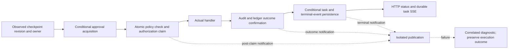

# NOVA-R01-C03 Completion Report

Date: 2026-11-17 (Asia/Calcutta). Status: VERIFIED for the operational paths and faults described below. This implementation does not independently close NOVA-R01.

## Implementation Summary
Corrected V03-F01 and V03-F02. Notification failures no longer convert successful writes into authorization denials. Runtime-owned execution progress and an identity-bound ledger read distinguish genuine rejection, committed execution, confirmed outcomes and uncertainty. Both checkpoint stores enforce sequence and owner together, prohibit owner replacement and terminal overwrites, and preserve history.

Final verification: 203 tests passed; 13 C03 real HTTP/process scenarios passed; the existing C01 harness passed 12 checks; the C02 revocation race harness passed. git diff --check passed. No dependency installation, commit, push, destructive migration or R02 work occurred.

## Baseline and Files Changed
Branch main; HEAD d94a2ff2bc836ef23deab158178576a191b89392, unchanged. The initial working tree was clean. before-hashes.json captures the pre-implementation application/test files; implementation.diff records the tracked patch. All 118 files in verification-start-hashes.json matched verification-end-hashes.json during final live verification. This hash comparison is separate from the intentional implementation changes.

Paths below are relative to services/backend/src/nova:

| File | Purpose |
|---|---|
| core/orchestration/ports.py | Trusted ExecutionProgress/ExecutionPhase, identity-mismatch and unconfirmed-outcome error contracts; optional progress argument on executors. |
| core/orchestration/state.py | Private checkpoint origin (observed sequence and owner), preserved through immutable domain state copies; not persisted or exposed as model/user input. |
| core/orchestration/checkpoint.py | Shared validation for SQLite and memory, explicit acquire/retain/release transitions, sequence/owner comparison, immutable terminal state and append-only checkpoint history. |
| core/orchestration/engine.py | Carry checkpoint expectations, isolate notification publication, verify persisted outcomes before terminal rejection, preserve uncertainty and explicit owner release. |
| core/permissions/authorization.py | Read-only exact-action outcome lookup; distinguishes a binding mismatch from storage unavailability. Existing claim/finish write transactions remain unchanged. |
| core/permissions/sandbox_and_audit.py | Executor phase updates, ledger confirmation, phase-aware rejection auditing, preservation of replay rejection and uncertain claim outcomes. |
| api/app.py | Central HTTP 503 mapping for unconfirmed execution/finalization, exposing persisted task status and recovery requirement. |
| api/assistant_ui.py | Let unconfirmed outcomes reach that handler rather than auditing them as authorization rejections. |

Tests modified:
- tests/permissions_security/test_c01_corrections.py: the post-write audit fault now expects explicit uncertainty and no invented tool/task failure. Real file, claimed-ledger and uncertain-activity assertions remain.
- tests/permissions_security/test_c02_lifecycle.py: event-store faults expect the typed error and retain the underlying SQLite exception check, rollback/no-write/state assertions.

Tests added:
- tests/permissions_security/test_c03_corrections.py: 30 cases covering both real note/calendar handlers, notification fault types and phases, both checkpoint stores, ownership transitions, stale writers, persistence faults, claim-return ambiguity and legacy checkpoint compatibility.
- tests/integration/c03_live_api.py: standalone localhost process/fault harness; 13 scenarios with actual handlers and synthetic storage.

New documentation/evidence resides in this report directory, the C03-live-* directories and fresh C01/C02 JSON artifacts listed in the evidence index. No earlier report or evidence archive was replaced. changed-files.json lists changes against the initial file hashes; Git status records include the newly added files.

## Architectural Reasoning and ADR Compliance
The change stays within orchestration, checkpoint storage, executor lifecycle and error presentation. ADR-001: all verification/storage is local. ADR-002 and ADR-009: publication is distinguished from action outcomes, and durable task events remain readable through the existing SSE endpoint. ADR-003: observed revision plus owner governs writes. ADR-006: contracts remain explicit and use existing implementations. ADR-010: the existing policy check and single-use authorization claim remain atomic and non-bypassable.

No general event bus, model, MCP or UI redesign was introduced. No new persisted phase column or database migration was needed.

## Internal Workflow and Data Flow
1. Load checkpoint. Its private origin records the actual observed sequence and owner. State transformations carry that observation forward.
2. Acquire an awaiting approval using the original sequence and expected unowned identity, explicitly requesting acquire. The stored pending proposal must remain unchanged.
3. The executor performs its existing preflight checks. It records CLAIM_PENDING before entering the authorization claim call, then CLAIM_COMMITTED only after that call returns.
4. The policy/claim transaction still checks persisted policy, validates the bound authorization, changes the ledger to claimed and records the claim under BEGIN IMMEDIATE.
5. tool.started is published after claim. The handler then runs. Its return is recorded as HANDLER_RETURNED, not immediately assumed durable success.
6. Required audit/outcome persistence completes. An identity-bound read must confirm success/error before OUTCOME_CONFIRMED is set.
7. Notification publication has its own exception boundary. Failures produce sanitized diagnostics containing event/task/correlation identity and exception class, not arbitrary exception text, tokens or user content. They do not become rejection audit entries.
8. Checkpoint/task terminal persistence remains required. If it cannot finish, HTTP reports an unconfirmed/finalization failure rather than inventing success or denying a write that happened.
9. Task terminal events remain atomically stored with terminal checkpoints. SSE merges persisted and live task events by event ID. Restart never replays an owned/uncertain action.

## Error and Outcome Semantics
| Situation | Result |
|---|---|
| Proven revocation before claim | Existing rejection audit; FAILED/task.failed; HTTP 409; no start event or write. |
| Identity/argument mismatch | Genuine rejection remains rejected and audited; it is not confused with a failed database lookup. |
| Claim commits but return is lost | Ledger establishes claimed; no pre-claim denial. HTTP 503, owned RUNNING state and no automatic replay. |
| Ledger lookup unavailable during ambiguous claim | Outcome remains unconfirmed; no fabricated rejection record. |
| Handler error with persisted error outcome | Normal failed execution, with partial side-effect semantics retained. |
| Handler succeeds but required audit/ledger persistence fails | HTTP 503; RUNNING/claimed remains, actual write retained, no fabricated terminal success or denial. |
| Ledger success confirmed but later finalization unavailable | Report finalization uncertainty, exposing known execution outcome separately from task state. |
| Publisher raises authorization, type or I/O exception | Preserve committed action result; log publication degradation. |
| Process crash | No automatic write replay. Ledger/checkpoint evidence remains the recovery basis. |

The actual HTTP 503 response includes detail (stable reason code), task_id, task_status, execution_outcome and recovery_required=true. No new TaskStatus enum value was added. Successful and genuine-denial response contracts remain compatible; uncertain persistence errors deliberately have an explicit 503 classification.

## Checkpoint Invariant and Concurrency Design
Validation runs under BEGIN IMMEDIATE in SQLite and an RLock in memory. The expected sequence and expected owner must both match the stored checkpoint. An explicit expectation must also agree with the source state's original observation; a stale state cannot be silently rebased by supplying a newly read sequence.

- None to None: ordinary update against the observed revision.
- None to A: explicit acquisition of a matching pending approval, awaiting_approval to running.
- A to A: same-owner update against the observed revision.
- A to None: explicit release for graph continuation, after pending proposals have been cleared by the outcome/observation path.
- A to B: rejected, including when the caller supplies the current sequence and correct prior owner.
- Terminal replacement: rejected regardless of protect_terminal. Exact idempotent saves do not create another checkpoint or terminal event.

protect_terminal remains an accepted compatibility argument but cannot disable these invariants. INSERT replaces the prior INSERT OR REPLACE history behavior. New sequences must advance. Acquisition/release are internal runtime operations; the owner token is a concurrency identity, not an authentication credential or a defense against arbitrary code with direct database access.

Older checkpoint JSON without approval_attempt_id still loads as owner None. Private checkpoint origins are reconstructed from stored envelopes, excluded from JSON, and require no migration. A new regression loads a synthetic old-format pending checkpoint and completes a real note action.

## Actual Commands and Results
Executed from C:\NOVA using its existing .venv Python. environment.json records installed versions. commands-all.json, commands-complete.json and commands-verified.json retain commands, exit codes and outputs; the live records additionally retain exact child-process launch commands, PIDs and exit codes.

| Command | Final result | Evidence |
|---|---|---|
| .venv/Scripts/python.exe -B -m pytest -q --tb=short | exit 0; 203 passed in 21.11 s | regression-complete.txt |
| .venv/Scripts/python.exe -B -m pytest --collect-only -q | exit 0; 203 collected | collection-verified.txt |
| .venv/Scripts/python.exe -B -m pytest tests/permissions_security/test_c03_corrections.py -q --tb=short | exit 0; 30 passed | targeted-verified.txt |
| .venv/Scripts/python.exe -B tests/integration/c03_live_api.py | exit 0; 13 PASS scenarios | live-c03-complete.txt and linked JSON |
| .venv/Scripts/python.exe -B tests/integration/c01_live_api.py | exit 0; 12 PASS checks | live-c01-complete.txt and linked JSON |
| .venv/Scripts/python.exe -B tests/integration/c02_live_api.py | exit 0; original V02 race PASS | live-c02-complete.txt and linked JSON |
| git diff --check | exit 0 | diff-check-complete.txt |

Intermediate failures are preserved. The first run passed 171/173 and exposed old expectations for uncertain outcomes. A targeted run passed 37/40 and exposed replay-classification regressions plus an over-broad assertion edit; the normal handler-failure assertion was restored. Later runs exposed six identity-forgery classification failures (writes remained blocked). Those were corrected by distinguishing a proven binding mismatch from unavailable evidence while retaining the original security assertions. Final full-suite execution passed all 203 tests. Passing intermediate runs are retained as well.

## Real Operational Evidence
Final C03 artifact: ../C03-live-1794890017536426600/fresh-challenges.json. live-summary.json extracts HTTP/status/side-effect comparisons.

| Scenario | Observed result |
|---|---|
| Exact V03 note publication fault | HTTP 200; completed; ledger success; one Markdown note; correlated task.completed; no false rejection audit. |
| Same fault with actual calendar handler | HTTP 200; completed; ledger success; one calendar SQLite row; correlated task.completed. |
| Two-process concurrent approvals | One 200 and one 409; one note; completed winner survives retry. |
| Separate-process owner replacement during committed claim | CheckpointConflict despite current sequence and correct expected old owner. Competing HTTP approval returns 409. Later revocation does not invalidate the already-claimed action; original process completes one note. |
| Failed terminal winner | Real denial persists failed; another process's retry is rejected; zero writes. |
| Task-event publisher fails before append | Durable failed event remains visible after restart; no duplicate terminal event. |
| Event-storage trigger rejects finalization | HTTP 503; RUNNING; no note and no invented terminal event. |
| Ledger-success update fails after note write | HTTP 503; RUNNING/claimed; one note; restart/retry creates no second write. |
| Outcome-audit insert fails after note write | Same conservative result: one real note, claimed ledger, no false terminal outcome. |
| Claim return fails after commit | HTTP 503; RUNNING/claimed; zero files; no replay. |
| Crash after ownership | Deliberate process exit 81; RUNNING/pending ledger; zero files; restart does not execute. |
| Crash after claim | Deliberate exit 82; RUNNING/claimed; zero files; restart does not execute. |
| Crash after real handler write | Deliberate exit 83; one note, claimed ledger, no replay after restart. |

The C02 harness independently reran revocation before claim: HTTP 409, persisted FAILED, correlated task.failed, zero tool.started and zero writes. The C01 harness verified normal note/calendar success, denial, revocation ordering, concurrent calendar approvals, expiry, replay and its own post-write crash (exit 73).

JSON records contain actual HTTP responses, task snapshots, SSE envelopes, Markdown content, calendar rows, authorization state and attempt identities. All content was synthetic. Normal harness shutdown uses Windows terminate(), recorded as exit 1; this is distinct from intentional crash codes and harness exit 0. All owned server processes were stopped.

## Security Review and Verification Scope
The atomic policy/claim transaction and revocation implementations were preserved. Genuine pre-claim checks still fail closed. The final suite retains tests for task/session/node/role/argument binding, token forgery, expiry, replay, concurrent claims and audit failures. In the exercised scenarios, no unauthorized writes, duplicate writes or successful approval replays were observed.

New failure injection uses real runtime components, SQLite and handlers. Publication hooks and process exits control the fault timing; they do not fabricate handler results. The full suite also includes mock model adapters and in-memory tool executors. Those are deterministic regression evidence, not evidence of live inference, browser/audio operation or MCP transport. No additional capability is claimed for those integrations.

## Remaining Limitations
- Checkpoint/authorization databases and filesystem writes are not one transaction. A write can exist while its outcome remains unconfirmed; this is reported rather than replayed.
- Interrupted owned actions remain RUNNING and require inspection. No automatic takeover, owner expiry or reconciliation workflow was introduced. Ownership-only crashes still lack a dedicated UI recovery notice.
- Only task terminal events are durable under the existing design. Tool notification delivery can be lost after a reservation/publication fault. Diagnostics identify degradation; no exactly-once delivery guarantee is made.
- SSE remains the existing finite snapshot with durable terminal recovery, not a continuous subscription or cursor-based event replay service.
- Publication diagnostics use local logging; no new durable diagnostic store was added. Failure of the logging infrastructure itself was not exhaustively tested.
- Process crashes, injected SQLite faults and controlled ordering were tested; physical power loss, arbitrary disk corruption and every possible interleaving were not.
- Existing clients/callers must handle the new explicit ExecutionOutcomeUnavailable/HTTP 503 result for uncertain required persistence. Unsafe direct checkpoint overwrite calls are intentionally rejected even with protect_terminal=False.
- Compatibility was verified with current tests and a synthetic legacy checkpoint. No real personal database was opened for migration testing.

## Knowledge Transfer
Execution, required persistence and notification delivery are separate facts. A publisher exception is evidence about a notification, not permission to rewrite the history of a handler that already succeeded. Similarly, a current sequence alone does not identify the runtime entitled to update a task: the expected owner and the requested owner transition must also match. Private observation metadata prevents ordinary state copies from forgetting the revision they were built from.

## Current Status and Next Milestone
V03-F01 correction: VERIFIED in real note/calendar publication and persistence fault paths.
V03-F02 correction: VERIFIED in SQLite, in-memory and separate-process ownership challenges.
Overall NOVA-R01 closure: pending review; this implementation report is not an independent audit.

Recommended next milestone: an independent C03 challenge verification against the final source and evidence before closing NOVA-R01.

## Source References and Evidence Index

- Trusted phase/error contracts: [core/orchestration/ports.py:59](C:/NOVA/services/backend/src/nova/core/orchestration/ports.py:59).
- Private observed checkpoint revision: [core/orchestration/state.py:175](C:/NOVA/services/backend/src/nova/core/orchestration/state.py:175).
- Shared sequence/owner invariant: [core/orchestration/checkpoint.py:50](C:/NOVA/services/backend/src/nova/core/orchestration/checkpoint.py:50).
- SQLite transaction and append-only persistence: [core/orchestration/checkpoint.py:271](C:/NOVA/services/backend/src/nova/core/orchestration/checkpoint.py:271).
- Exact-action outcome read: [core/permissions/authorization.py:185](C:/NOVA/services/backend/src/nova/core/permissions/authorization.py:185).
- Existing atomic claim: [core/permissions/authorization.py:146](C:/NOVA/services/backend/src/nova/core/permissions/authorization.py:146).
- Phase-aware rejection auditing: [core/permissions/sandbox_and_audit.py:282](C:/NOVA/services/backend/src/nova/core/permissions/sandbox_and_audit.py:282).
- Claim phase boundary: [core/permissions/sandbox_and_audit.py:1038](C:/NOVA/services/backend/src/nova/core/permissions/sandbox_and_audit.py:1038).
- Conditional approval resolution: [core/orchestration/engine.py:395](C:/NOVA/services/backend/src/nova/core/orchestration/engine.py:395).
- Isolated publisher: [core/orchestration/engine.py:967](C:/NOVA/services/backend/src/nova/core/orchestration/engine.py:967).
- HTTP uncertainty mapping: [api/app.py:434](C:/NOVA/services/backend/src/nova/api/app.py:434).

- [C03 live evidence](../C03-live-1794890017536426600/fresh-challenges.json)
- [C01 live evidence](../C01-live-nova-c01-live-njj6ukjz.json)
- [C02 race evidence](../C02-live-nova-c02-http-0fllnrjs.json)
- [Complete regression output](regression-complete.txt)
- [Commands and exit codes](commands-all.json)
- [HTTP/persistence summary](live-summary.json)
- [Verification hash comparison](verification-integrity.json)

The targeted 30-case output predates the last binding-mismatch correction; all 30 cases were included again in the final 203-test run. Earlier failed logs are retained.
